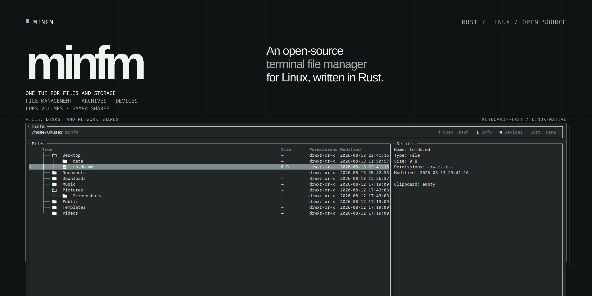

# minfm

<p>
  <a href="https://github.com/shukzi/minfm/actions/workflows/ci.yml"></a>
  <a href="https://github.com/shukzi/minfm/releases/latest"></a>
  <a href="LICENSE"></a>
</p>

A minimal terminal file manager for Linux, written in Rust. Browse files, manage
drives, and unlock encrypted volumes from one keyboard-driven interface.



## Features

- Arrow-key and Vim-style navigation, with tree and table views.
- Create, rename, copy, move, and trash files, with multi-selection.
- Search by filename, metadata, or file contents.
- Create, browse, and extract TAR and ZIP archives.
- Manage disks, partitions, filesystems, and LUKS volumes.
- Browse Samba shares and transfer files between local and network storage.
- Customize shortcuts, icons, and your preferred editor.

Storage and network tools are optional. minfm works as a regular file manager
without them.

## Install

Install the latest release:

```sh
curl -fsSL https://github.com/shukzi/minfm/raw/main/install.sh | sh
```

Then run:

```sh
minfm
```

The installer supports Linux x86-64, verifies the download's checksum, and
installs to `~/.local/bin`. It also installs the bundled icon font and offers
optional packages for Fedora, Debian/Ubuntu, and Arch Linux.

To update, run the installer again or accept minfm's startup update prompt. Your
configuration is preserved.

<details>
<summary>Install a specific version</summary>

Pin the installer and release to the same tag:

```sh
curl -fsSL https://github.com/shukzi/minfm/raw/v0.1.0/install.sh | MINFM_VERSION=v0.1.0 sh
```

</details>

## Get started

- Navigate with the arrow keys or Vim-style controls.
- Press `/` for quick search or `F` for advanced search.
- Press `z` to create, inspect, or extract an archive.
- Press `m` for tools, `M` for devices, or `N` for network shares.

Configuration is optional. To customize minfm, copy the
[example configuration](config.example.toml) to `~/.config/minfm/config.toml`.

See the [user guide](docs/guide.md) for installation details, configuration,
search, archives, safety, and uninstall instructions.

## Build from source

With a current stable Rust toolchain installed:

```sh
git clone git@github.com:shukzi/minfm.git
cd minfm
cargo build --release --locked
./target/release/minfm
```

## Safety

Normal deletion uses the desktop trash. Destructive storage operations require
confirmation and include checks to protect system devices. Keep backups:
formatting, partitioning, and erasure are not reversible.

## Feedback

Bug reports and feature suggestions are welcome. Use the
[issue forms](https://github.com/shukzi/minfm/issues/new/choose).

minfm is developed and maintained by shukzi. External pull requests are not
accepted; propose improvements in an issue instead.

See [CONTRIBUTING.md](CONTRIBUTING.md), the [roadmap](ROADMAP.md), and the
[security policy](SECURITY.md).

## License

[MIT](LICENSE) · Copyright © 2026 shukzi.
